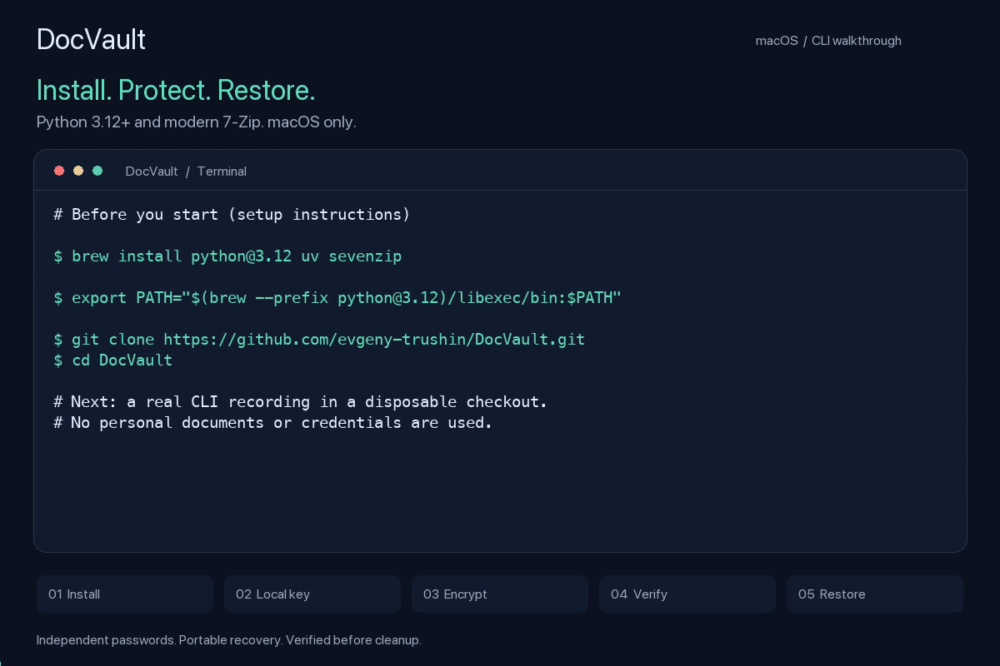

# Installation and usage demo



[MP4 video](media/demo.mp4)

The opening card shows prerequisite and clone instructions. The remaining scenes
replay real terminal output captured from a fresh, disposable source checkout on
macOS: install locally, create a key, encrypt two sample text files, verify the
bundle, move the originals aside and restore them. The recording checks that both
restored files match their originals. Timing is shortened, terminal paths are
abbreviated to `$PWD`, and passwords remain hidden. No system launchers or keys
are modified. `--keep` is used so the sample originals are retained.

## Follow along

```sh
brew install python@3.12 uv sevenzip
export PATH="$(brew --prefix python@3.12)/libexec/bin:$PATH"
git clone https://github.com/evgeny-trushin/DocVault.git
cd DocVault
./install.sh --bin-dir "$PWD/.demo/bin"
export PATH="$PWD/.demo/bin:$PATH"
mkdir -m 700 .demo/key
docvault init --key .demo/key/key
mkdir Documents
printf 'Sample documents for the DocVault demo.\n' > Documents/notes.txt
printf 'Demo invoice: 42 AUD\n' > Documents/invoice.txt
encrypt.sh Documents --key .demo/key/key --keep --key-hint "" --outer-hint ""
docvault verify Documents.7z
mv Documents Documents.original
decrypt.sh Documents.7z
diff -r Documents.original Documents
```

Use a fresh checkout without existing `Documents` or `.demo` folders for these
steps. Choose your own strong, independent passwords when prompted. An empty hint
option skips its public prompt; omit the options to enter public memory cues.
For normal installation locations and the default protected key, see the README.

## Regenerate

```sh
brew install ffmpeg
uv pip install --python .venv/bin/python -e '.[demo]'
.venv/bin/python scripts/record_demo.py
```

The recorder requires macOS, uv, Python 3.12+, modern 7-Zip, Pillow and FFmpeg.
It creates a temporary source checkout and fresh virtual environment, so dependency
installation may need network access. It generates random demo credentials in
memory, refuses to type them with terminal echo enabled, checks the transcript for
leaks and removes the disposable checkout afterwards. The redacted transcript is
saved alongside the media. Use `--reuse-recording` to render that transcript again
without repeating CLI operations. Preview PNGs are local review files and are not
included in Git.
